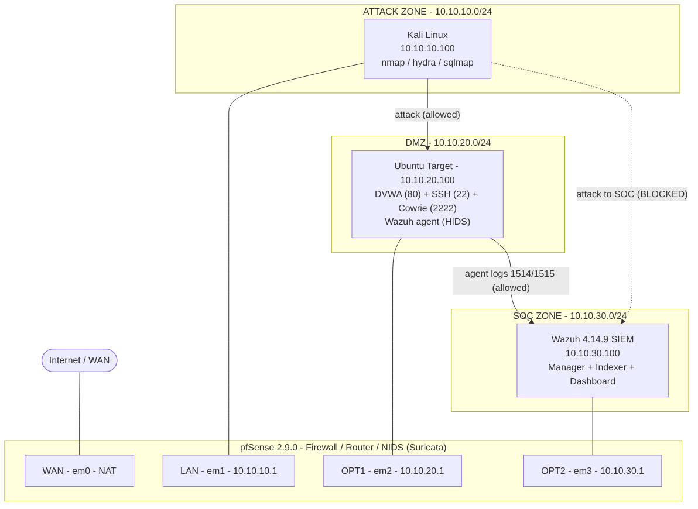
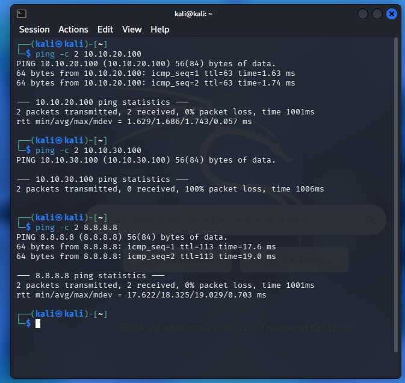
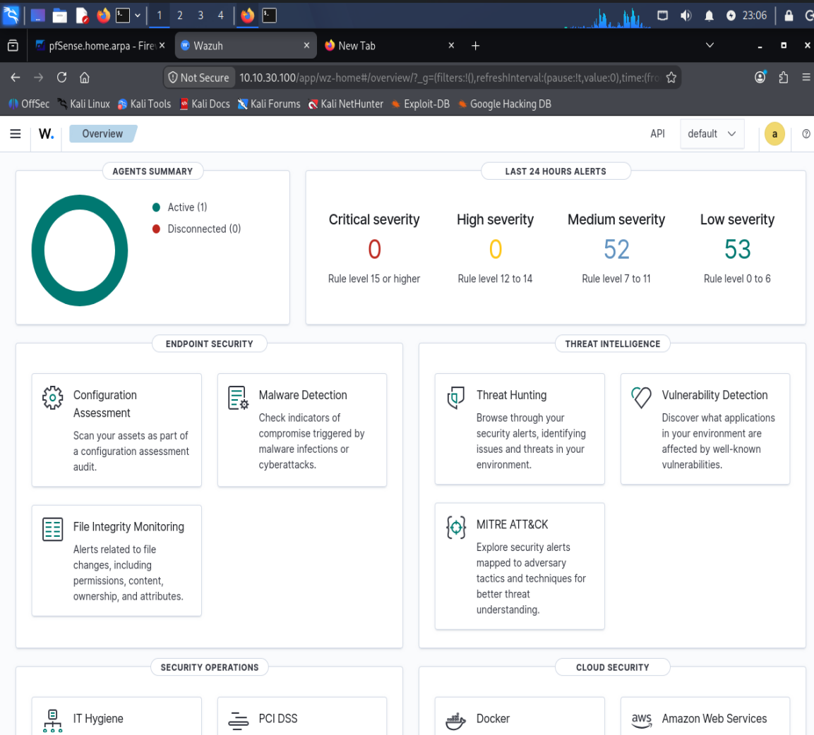
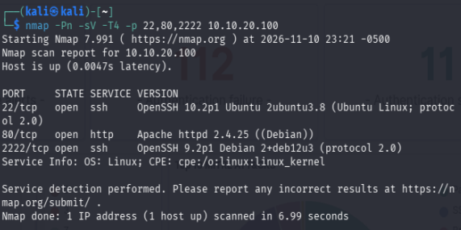
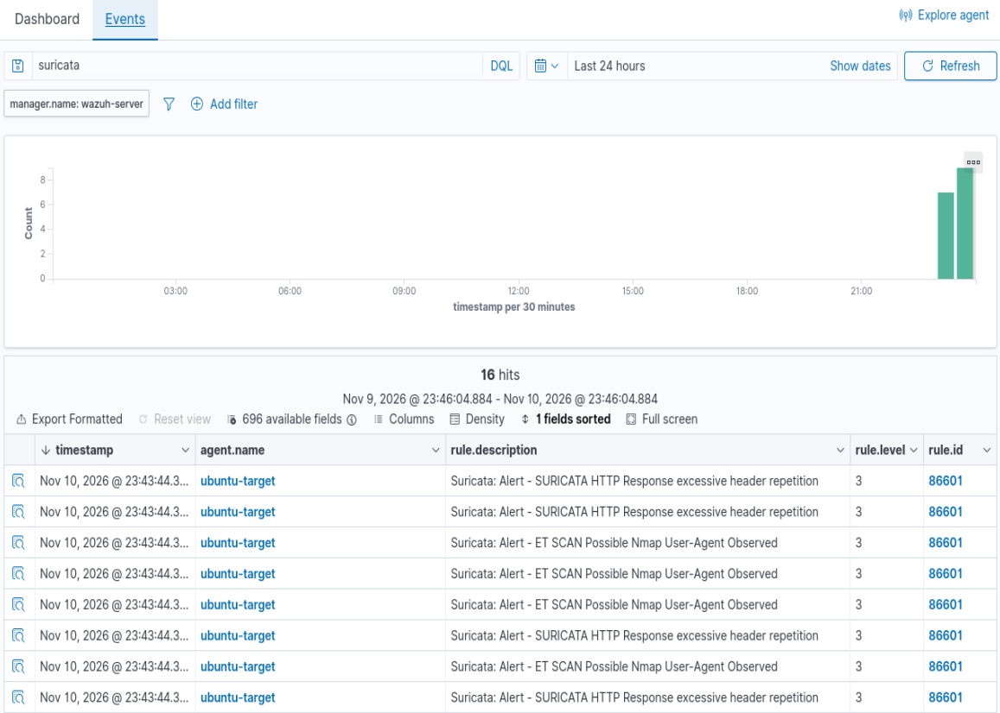
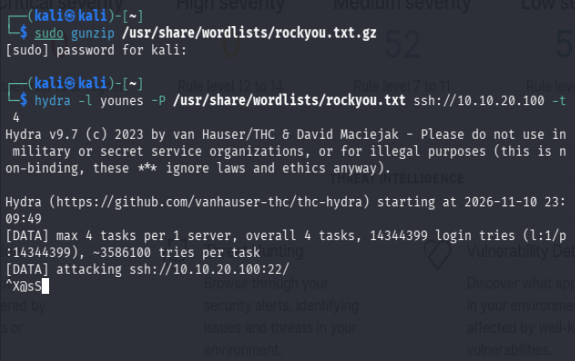
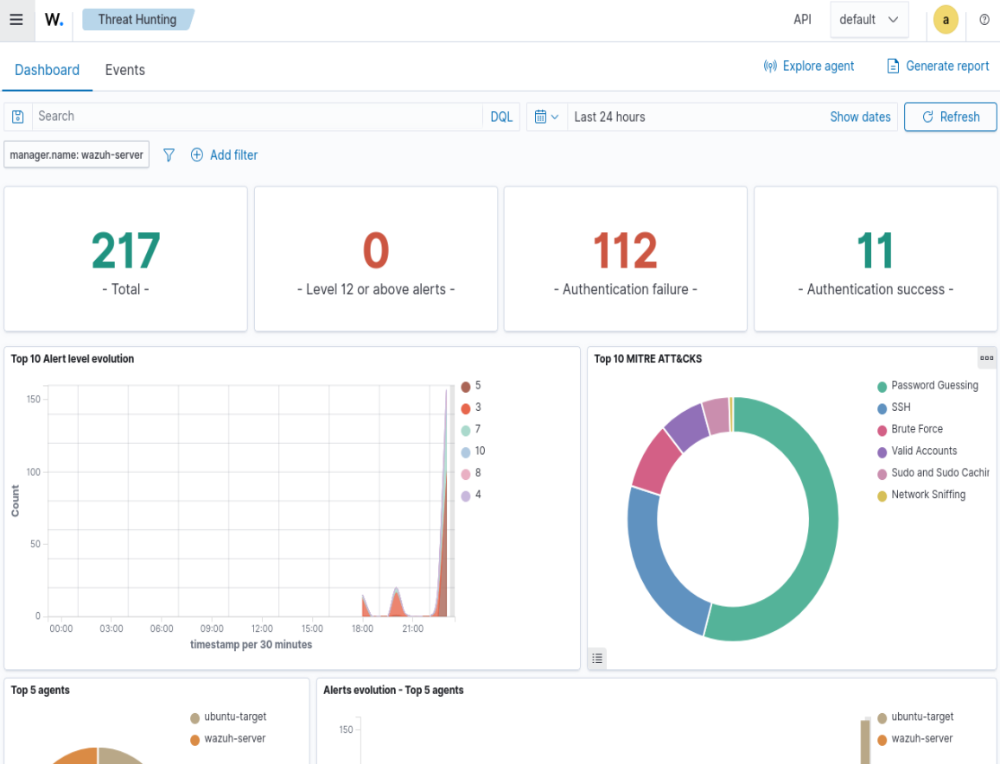
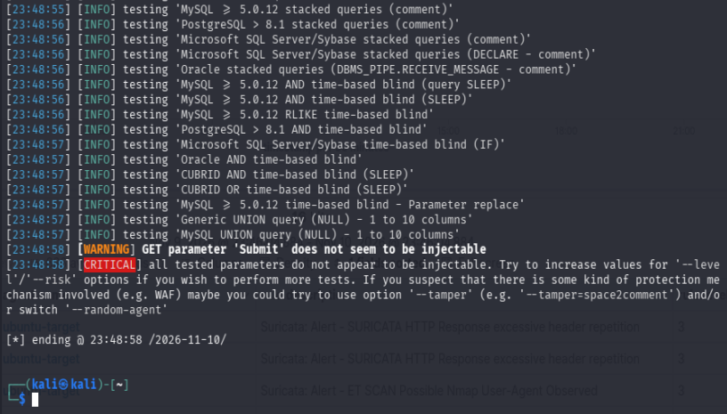

# SOC Lab — Segmented Purple Team SIEM Environment


## General

This project builds, operates and documents a small Security Operations Center (a SOC is the team that monitors, detects and investigates security events). The goal is to reproduce the day-to-day work of a SOC analyst: deploy the monitored infrastructure, run attacks against it, and show that the detection chain catches them.

We did not want a flat lab where every machine can reach every other one, because that is not how a real company is built. So we segmented the environment into three isolated zones separated by a firewall (a device that filters traffic between networks). The segmentation is the point of the lab: it lets us tell one clear story — the attacker can reach the exposed target, but is blocked from reaching the monitoring system that watches it.

Everything runs locally on a single workstation, with no exposure to any real network. The lab is purely educational, so there was no reason to expose anything.

## Architecture

The whole lab runs on VirtualBox on one host, with four virtual machines and three internal networks acting as VLAN-like zones (segments kept separate from each other).



| Zone | Network | Machine | Role |
|------|---------|---------|------|
| Attack | `10.10.10.0/24` | Kali Linux (`.100`) | Attacker — nmap, hydra, sqlmap |
| DMZ | `10.10.20.0/24` | Ubuntu Server (`.100`) | Exposed target — DVWA + SSH + Cowrie honeypot + Wazuh agent |
| SOC | `10.10.30.0/24` | Wazuh (`.100`) | SIEM — Manager + Indexer + Dashboard |
| Router | — | pfSense | Firewall / router between the zones |

pfSense owns the gateway address of every zone (`.1`) and routes traffic between them according to a strict policy. Four machines, three zones, one firewall — a compact replica of an enterprise network built to be attacked and observed.

## Firewall policy

The segmentation is only real if the firewall enforces it. We wrote the rules so that the attacker can hit the target but can never touch the system that monitors it.

| From → To | Decision | Reason |
|-----------|----------|--------|
| Attack → DMZ | Allowed | the attacker must be able to reach the exposed target |
| DMZ → SOC (agent ports 1514/1515) | Allowed | the agent must ship its logs to the SIEM |
| Attack → SOC | Blocked | the attacker must not reach the monitoring system |
| DMZ → SOC (anything else) | Blocked | the target has no business talking to the SIEM outside the agent |
| Any zone → Internet | Allowed | updates and package installation |

We tested the policy before trusting it: from Kali, `10.10.20.100` (the DMZ target) answers while `10.10.30.100` (the SOC) times out, and the pfSense firewall log shows the block. The attacker is observed without being able to touch what observes it.



## Detection stack

Detection is built in two complementary layers, which is how a real SOC is structured.

- **HIDS** (Host-based Intrusion Detection System — an agent installed on the machine itself): the Wazuh agent on the Ubuntu target reads its local logs (SSH authentication, file integrity, processes) and ships the events to the manager.
- **NIDS** (Network-based Intrusion Detection System — inspects the traffic on the wire): Suricata watches the packets and raises an alert when a signature matches.
- **SIEM** (Security Information and Event Management — the central console): Wazuh collects everything, correlates it against its rules, and maps the alerts to MITRE ATT&CK (the standard catalogue of attacker techniques).

Host-level and network-level visibility feed a single SIEM that turns raw logs into MITRE-mapped alerts.

The agent on the target enrolls into the manager and reports as active:



## Attack scenarios (Purple Team)

Purple Team means we play both sides: we run the attack (red) and we check the detection (blue). Each scenario is executed from the Attack zone, then found again from the SIEM. The proof screenshots are in `captures/`.

### 1. Network reconnaissance — nmap scan (detected)

We ran a service scan from Kali against the target (`nmap -sV`). A port scan is the first thing an attacker does: it maps which services are open before choosing how to get in. Suricata picked up the scan and the alert reached the Wazuh dashboard. MITRE: T1595 — Active Scanning.





### 2. SSH brute force — hydra + Cowrie (detected)

We threw a dictionary of passwords at the SSH service with hydra. Brute force is the attempt to guess credentials by trying many of them in a row. The Wazuh agent read the authentication log and the manager raised the brute-force alert, with the repeated failed logins visible in the dashboard. MITRE: T1110 — Brute Force.





### 3. SQL injection — DVWA + sqlmap (in progress)

We ran sqlmap against the DVWA injection point (`?id=1`). SQL injection abuses an input that is concatenated straight into a database query, letting the attacker read data that is not theirs. The attack itself works — sqlmap dumps the database. The detection side is still being finished: the generic Suricata SQLi signatures are deprecated, so a dedicated rule is being written and validated. The real detection capture will be added once it fires. MITRE: T1190 — Exploit Public-Facing Application.



## Future work

- Finish the SQL injection detection (scenario 3): write and validate a dedicated Suricata rule, then add the real alert capture.
- Add an Active Directory layer (a Windows domain controller) and run AD-specific attacks — Kerberoasting, BloodHound enumeration.
- Forward the pfSense firewall logs to Wazuh so the firewall itself becomes a log source, not only a filter.
- Add a few custom detection rules and tune the alerts to cut the noise, which is the real daily work of a SOC analyst.

## Repository structure

```
soc-lab/
├── README.md
├── diagrams/
│   └── architecture.png
└── captures/              # proof screenshots (attack + alert), per scenario
```

## Lab specifications

- **Hypervisor:** VirtualBox 7.x (single host)
- **Firewall:** pfSense CE 2.9.0
- **SIEM:** Wazuh 4.14.9 (all-in-one OVA)
- **NIDS:** Suricata
- **Attacker:** Kali Linux
- **Target:** Ubuntu Server 26.04 LTS (Docker: DVWA, Cowrie)

## Disclaimer

All offensive content runs in a fully isolated virtual environment with no exposure to any real network. This lab is for educational purposes only.
